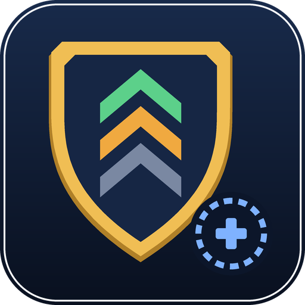

<p align="center">
  
</p>

<h1 align="center">Counter & Shop Helper</h1>

<p align="center">
  Mod Lua pour <b>Paladins 8.1</b> (Wekono's Wake, build 8.1.5839.0) · par <b>Machi Konno</b> · Discord : <code>machi.konno</code><br>
  Nécessite <b>Tempest Scripting</b> 1.0.0 ou plus · <a href="CHANGELOG.md">Journal des versions</a> · <a href="../../releases">Téléchargements</a>
</p>

---

**Sommaire** : [En bref](#en-bref) · [Fonctions](#fonctions) · [Touches](#touches-et-utilisation) · [Installation](#installation) · [Mises à jour](#mises-à-jour) · [English](#english) · [Crédits](#crédits)

## En bref
Le mod lit l'équipe adverse et te dit **quoi acheter, dans quel ordre, et qui surveiller**. Il affiche un petit panneau en jeu, dans ta langue, avec les noms officiels du jeu.

> 🔒 **Lecture seule.** Le mod n'achète rien, n'envoie rien au serveur et ne modifie aucun fichier du jeu. L'achat automatique est volontairement désactivé, car Tempest n'offre aucune fonction de boutique sûre.

## Fonctions
| | |
|---|---|
| 🛒 **4 objets + 1 en option** | 4 objets principaux dans l'ordre d'achat, avec le rang conseillé et une courte raison. Un **5e objet en option** (bordure bleue pointillée) dépend du déroulement de la partie. |
| 📈 **Lecture en direct** | Tes objets et leurs rangs sont lus dans le jeu. Gris = pas acheté, ambre = rang en cours, vert = rang conseillé atteint. Si tu achètes autre chose, le plan s'adapte autour. |
| ⚠️ **Menaces adverses** | Les compétences des ennemis, par exemple « Makoa : Ancre de drague (étourdit) ». |
| 🎯 **Sélection des champions** | Contres conseillés et meilleurs rôles face à l'équipe adverse. |
| 🌍 **8 langues natives** | English, Français, Deutsch, Italiano, Русский, 简体中文, 日本語, 한국어, ou Auto (langue de Steam / du jeu). Les noms d'objets, de rôles et de compétences sont ceux du jeu 8.1. |
| ✋ **Réglage manuel** | Si la lecture directe n'est pas disponible, tu règles tes objets dans l'onglet Partie (ils repartent de 0 à chaque session). |

## Touches et utilisation
| Touche | Action |
|---|---|
| `Ctrl+J` | Menu : Partie, Paramètres, Aide |
| `Ctrl+H` | Afficher / masquer le panneau |
| `Ctrl+K` | Basculer compact / détaillé |
| `Ctrl+O` | Paramètres |
| `Ctrl+L` | Verrouiller le panneau |

- Les touches se changent dans le menu. Toutes existent sur un clavier 60 %.
- Menu ouvert, glisse le panneau pour le déplacer ou tire son bord pour l'élargir. « Largeur automatique » remet la largeur calculée.
- Commandes de la console Tempest : `smartcounter` (menu), `smartcounter_probe` (rapport de détection), `smartcounter_items` et `smartcounter_items_watch` (lecture des objets), `smartcounter_selftest`. Les rapports vont dans `%TEMP%\tempest-scripting.log`.

## Installation
**Prérequis :** Paladins 8.1 avec Tempest et le mod **Tempest Scripting** installés.

**Avec le Tempest Launcher** (une fois le mod publié sur le dépôt Tempest) : cherche « Counter & Shop Helper » dans les mods du Launcher et installe-le.

**Depuis une GitHub Release :**
1. Télécharge `Paladins-SmartCounter-8.1-<version>.tempest` dans les [Releases](../../releases).
2. Installe ce fichier `.tempest` avec le Tempest Launcher, ou en ligne de commande :
   ```powershell
   tempest-cli.exe mod install "<dossier de Paladins>" "Paladins-SmartCounter-8.1-<version>.tempest" --replace
   ```
3. Lance le jeu : l'astuce « Counter & Shop Helper prêt » s'affiche, et `Ctrl+J` ouvre le menu.

> Le paquet est signé par l'auteur. Le Launcher peut indiquer un signataire « non officiel » : c'est le cas de la plupart des mods de la communauté.
> `--replace` met à jour une installation existante. L'identifiant du mod (`paladins-smartcounter-81`) ne change jamais.

## Mises à jour
- **Ce qui a changé :** [CHANGELOG.md](CHANGELOG.md), une section par version, la plus récente en haut.
- **Télécharger une version :** [Releases](../../releases). Chaque tag `vX.Y.Z` porte le paquet `.tempest` signé et les notes de cette version.
- **Version actuelle :** 0.6.2.

## English
**Counter & Shop Helper** is a Lua mod for Paladins 8.1 (Wekono's Wake), made by Machi Konno (Discord: `machi.konno`). It requires Tempest Scripting.
- **Shop plan:** 4 core items in buying order, plus 1 optional item (blue dashed border) that depends on the match.
- **Live reading:** your items and ranks are read from the game.
- **Threats and counter-picks:** enemy threats based on their own abilities, and counter-picks in champion select.
- **8 languages:** the game's own 8.1 names in every language.
- **Read-only:** no automatic buying, nothing sent to the server.

Keys: `Ctrl+J` menu · `Ctrl+H` panel · `Ctrl+K` compact/detailed · `Ctrl+O` settings · `Ctrl+L` lock.
Install the `.tempest` file from [Releases](../../releases) with the Tempest Launcher, or with `tempest-cli mod install "<Paladins folder>" <file> --replace`. Changes are listed in [CHANGELOG.md](CHANGELOG.md) (French).

## Crédits
- **Machi Konno** · Discord : `machi.konno`.
- Les noms d'objets, de compétences et de champions, et les icônes de la boutique, appartiennent à Paladins / Hi-Rez Studios.
- Le logo est une création originale.
- Mod non officiel, sans lien avec Hi-Rez Studios.
- Pour les développeurs : [DEVELOPPEMENT.md](DEVELOPPEMENT.md) (structure, moteur, tests) et [RELEASE.md](RELEASE.md) (publication Tempest et GitHub).
